# 机器学习 · 课程实验

机器学习课程的上机实验记录，包含完整的代码、图表与实验报告。

## 目录

```
machine-learning-coursework/
├── lab01-线性回归/                  实验一：一元与多元线性回归
│   ├── 实验1_线性回归.ipynb
│   ├── 实验报告.docx / .md
│   └── figures/                     2 张结果图
├── lab02-逻辑回归与朴素贝叶斯/       实验二：分类器对比
│   ├── 实验2_逻辑回归与朴素贝叶斯.ipynb
│   ├── 实验报告.docx
│   ├── results.json                 全部指标的结构化结果
│   ├── figures/                     12 张图
│   └── tools/                       报告与流程图的生成脚本
└── notes/                           课堂示例与练习
```

---

## 实验一 · 线性回归

用 BMI 数据集做单特征与多特征回归，重点验证三件事：

| 结论 | 数据支撑 |
| :--- | :--- |
| 训练集与测试集划分影响泛化评估 | 单特征模型测试 R² 明显低于训练 R² |
| 多特征优于单特征 | 加入全部特征后测试集误差下降 |
| 特征尺度影响梯度下降收敛 | 未标准化时收敛慢、迭代次数多 |

实现上不调用 `sklearn.linear_model`，用 NumPy 手写正规方程与梯度下降两条路径，
并与 sklearn 结果对拍，验证数值一致性。

---

## 实验二 · 逻辑回归与朴素贝叶斯

在二分类任务上对比两类概率模型，做了一轮比较系统的诊断。

### 对比维度

- **判别式 vs 生成式**：逻辑回归（判别式）↔ 高斯朴素贝叶斯（生成式）
- **正则强度**：L2 惩罚系数 λ 的网格搜索
- **决策阈值**：默认 0.5 之外扫描全阈值，观察 P/R 权衡
- **特征标准化**：对有/无标准化各跑一遍

### 图表清单

| 图 | 说明 |
| :--- | :--- |
| `fig_lr_flowchart` / `fig2_gnb_flowchart` | 两个模型的算法流程图 |
| `fig_lr_coef` | 逻辑回归各特征权重 |
| `fig_lambda_grid` | 正则强度 λ 对验证集表现的影响 |
| `fig_lr_lr_grid` | 学习率 × 迭代轮数的收敛曲面 |
| `fig_learning_curve` | 学习曲线（训练量 vs 误差） |
| `fig_standardization` | 标准化前后的收敛对比 |
| `fig_confusion` / `fig_pr_curves` | 混淆矩阵与 PR 曲线 |
| `fig_threshold` | 决策阈值扫描 |
| `fig_calibration` | 概率校准曲线 |
| `fig_seed_stability` | 随机种子对结果稳定性的影响 |

最后一张图值得单独说：**同一份数据换随机种子重跑，指标波动有多大** —— 很多教程只报
单次结果，容易让人误以为模型稳定。这里把波动幅度量化出来了。

### 复现

```bash
jupyter notebook 实验2_逻辑回归与朴素贝叶斯.ipynb
```

`tools/` 下的脚本用于从 `results.json` 自动重建报告与流程图，不参与建模。

---

## 实验一图表

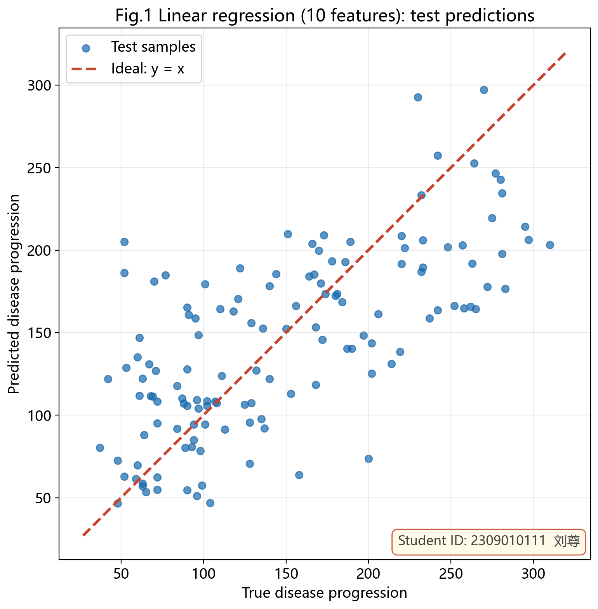

*十特征模型：测试集真实值（横轴）与预测值（纵轴），红色虚线为 y=x 参考线*

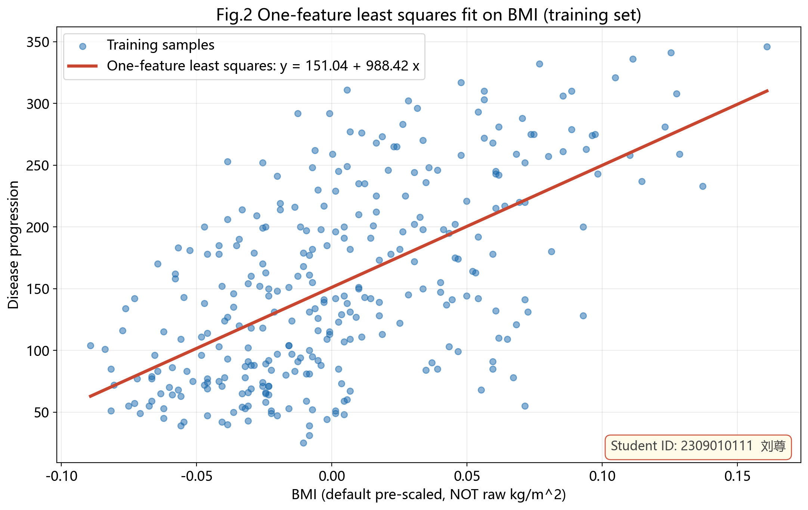

*训练集 BMI 与目标的散点，及一元最小二乘拟合直线*

---

## 实验二图表

### 算法流程图

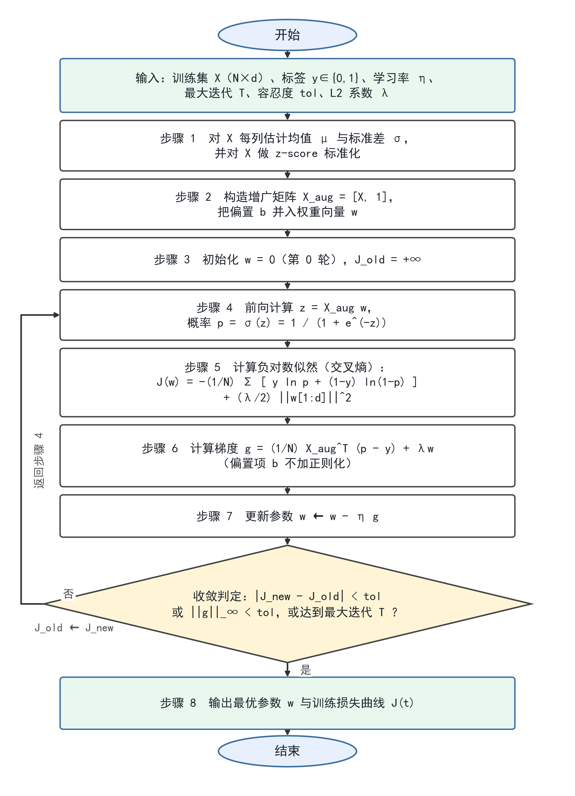

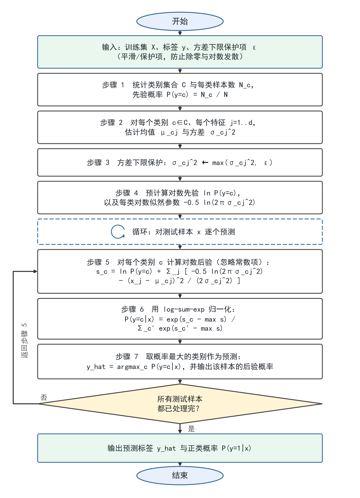

### 模型诊断

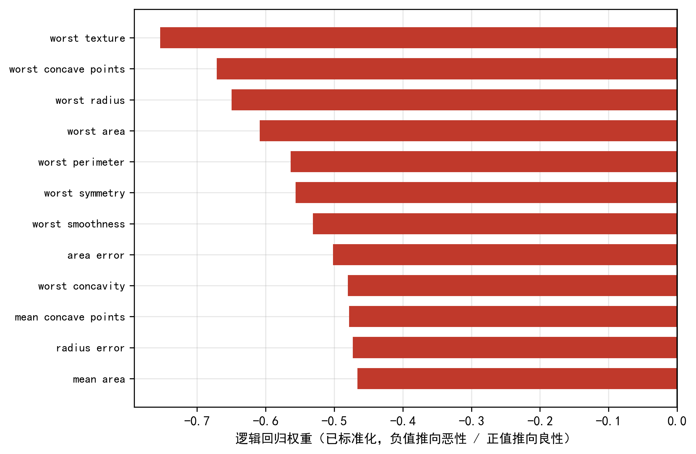

*逻辑回归各特征的权重*

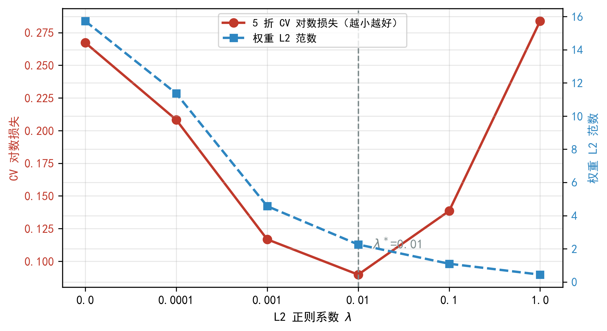

*L2 惩罚系数 λ 对验证集表现的影响*

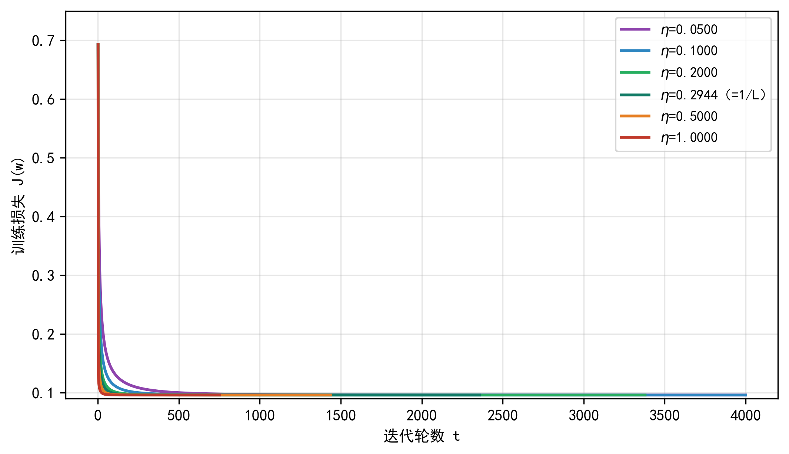

*学习率 × 迭代轮数的收敛曲面*

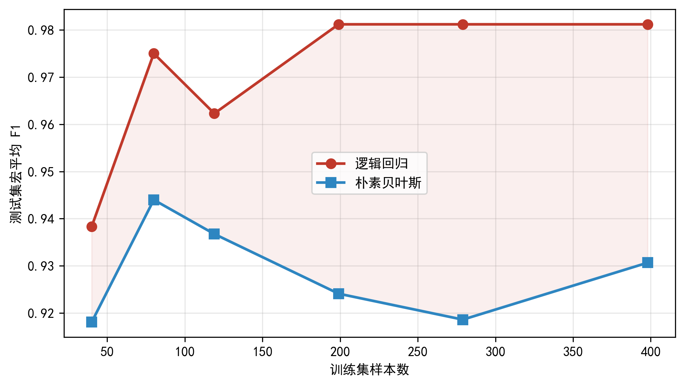

*训练量与误差的关系*

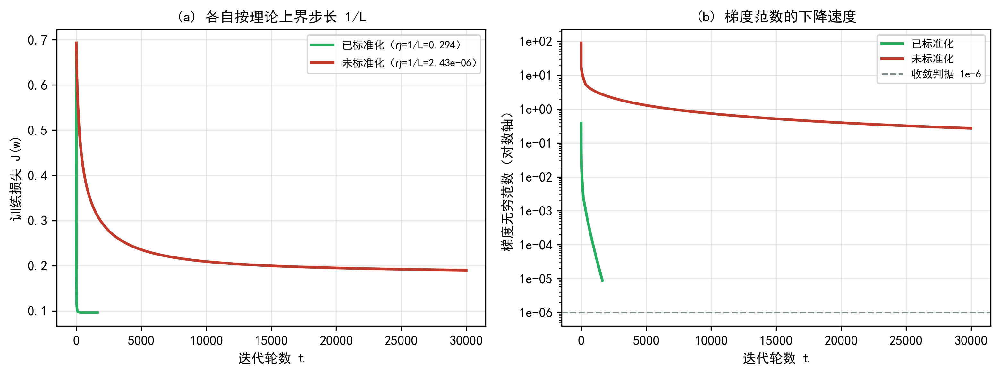

*有/无特征标准化时的收敛差异*

### 分类性能

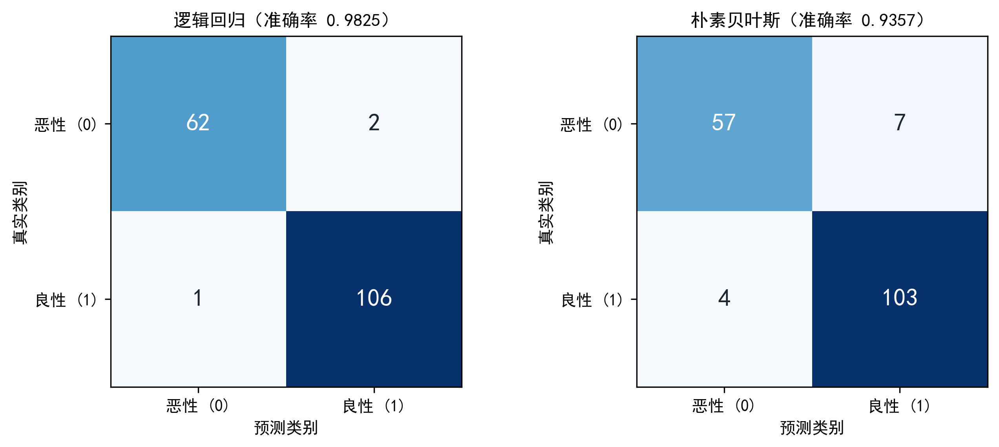

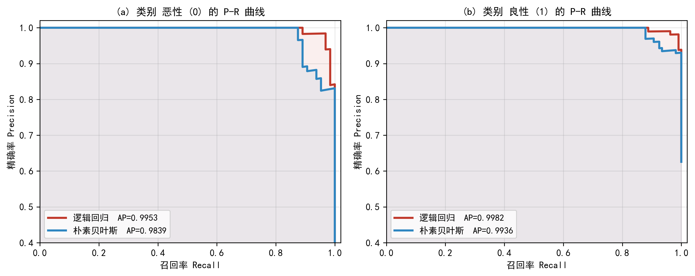

*两个模型的精确率-召回率曲线*

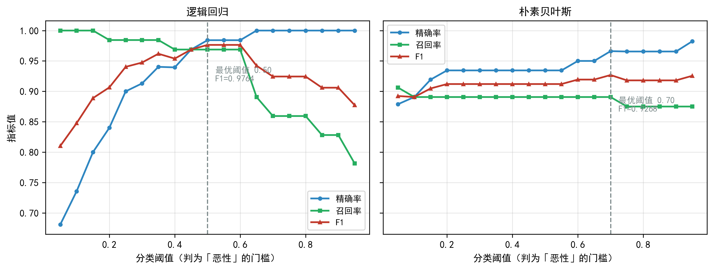

*决策阈值对精确率/召回率的影响*

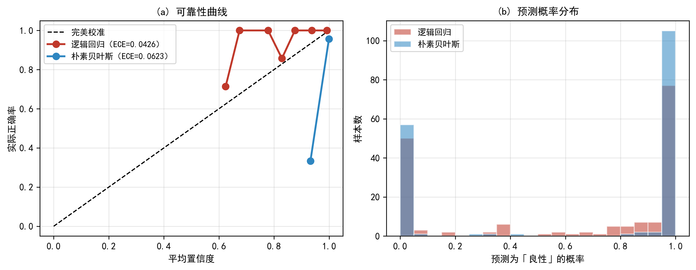

*预测概率与实际频率的一致性*

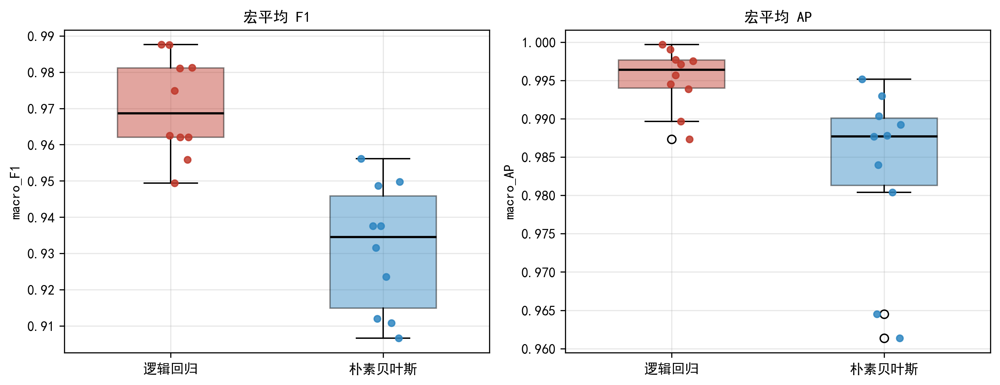

*同一数据换随机种子重跑，指标的波动幅度*

---

## 环境

- Python 3.12 · numpy · pandas · matplotlib · scikit-learn（仅用于对拍）
- 图表统一用 `tools/flowcharts.py` 的样式函数生成

## 关于课程材料

课程提供的课件、作业要求、评分标准与报告模板属于教学材料，未包含在本仓库中。
